<p align="center">
  <picture>
    <source media="(prefers-color-scheme: dark)" srcset="src/assets/img/logo/atrio-wordmark-light.svg">
    
  </picture>
</p>

<p align="center">A modern, redesigned web UI for <a href="https://casaos.zimaspace.com">CasaOS</a>.</p>

---

The atrium is the room you walk through when you enter a home. Atrio wants to be that for your home server: the first
thing you see, clean and quick to get around.

Atrio is a fork of [CasaOS-UI](https://github.com/IceWhaleTech/CasaOS-UI) by [IceWhale Technology](https://github.com/IceWhaleTech).
It talks to the standard CasaOS backend, so it replaces only the web interface: your apps, settings and data stay
the same.

<p align="center">
  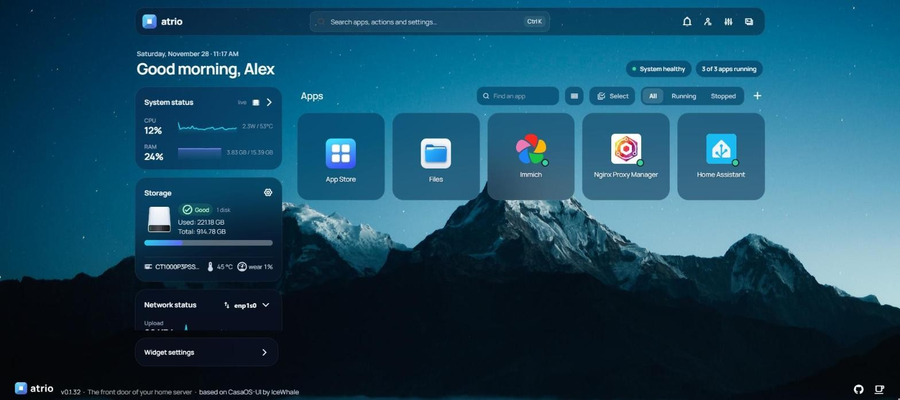
</p>

More on the website: **[atrio.peppeaiello.cloud](https://atrio.peppeaiello.cloud)**.

> **Status:** young but usable every day. The dashboard, App Store, app panel, install and settings forms, files,
> settings, account, console and notifications are redesigned; a few rarely used dialogs still look like CasaOS.

Atrio is an independent project, not affiliated with or endorsed by IceWhale Technology. CasaOS is a trademark of
its respective owners.

## Features

- **Calm glass dashboard** with a greeting, live CPU, memory, storage and network widgets, and status you can read
  without relying on colour.
- **App Store** with search first, categories and authors as chips, a clear installed state, and install progress
  right in the app grid.
- **A panel for every app**: open, restart, stop, update; overview, logs, terminal, settings and backups as tabs.
  Install and settings forms in sections, with errors that say what to type.
- **Backups for each app**: its settings and the folders you choose, to another disk, a USB drive, a network folder
  or a cloud drive connected in Files, by hand or automatically every day or week. Going back takes one click, and
  an update saves a backup first. Backups are encrypted and signed with a key that stays on the server.
- **Updates without fear**: new versions are found even for apps on `latest`, a backup is saved first, and the app
  goes back to its old version if it does not start again. Apps you choose can update on their own at night.
- **Many apps at once**: select apps and start, stop, restart or update them together.
- **Hardware details**: machine, BIOS, processor, memory and every sensor the machine reports, with the history of
  processor, memory, network and temperatures over 24 hours or 7 days.
- **Disk health**: a plain verdict from each disk's SMART data, temperature and wear, short self-tests every week and
  long ones every month at night, and a warning before a disk fails.
- **Network detail**: which apps are downloading or uploading right now, and their totals over 24 hours.
- **App health**: a dot on the tile and an alert when an app stops answering.
- **Notifications** for installs, updates, a disk almost full or unhealthy, and a hot processor, also as push
  alerts to your phone through ntfy, Gotify or Apprise, even when Atrio is closed, with quiet hours and your own
  limits.
- **A new file manager**: places in a sidebar, list and grid views, previews, upload by drag and drop, and a text
  editor that checks YAML and JSON.
- **One console** for the logs and terminals of the server and every app.
- **Widgets your way**: show, hide and reorder them, and add any web page of your network.
- **Command palette** (`Ctrl K`) to reach apps, actions and settings from the keyboard.
- **Updates in one click**, a progress screen, and Atrio back on its own after a CasaOS update.
- **Works on phones**, and can be added to the home screen as an app (over HTTPS).

<table>
  <tr>
    <td colspan="2">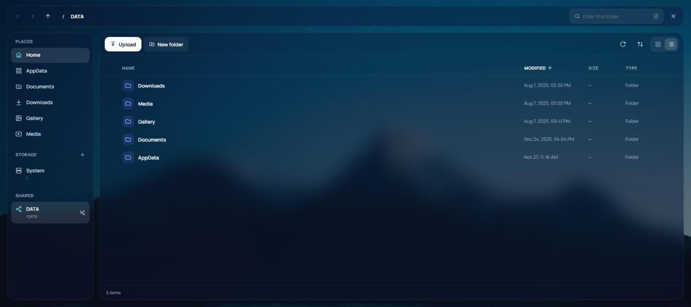</td>
  </tr>
  <tr>
    <td align="center">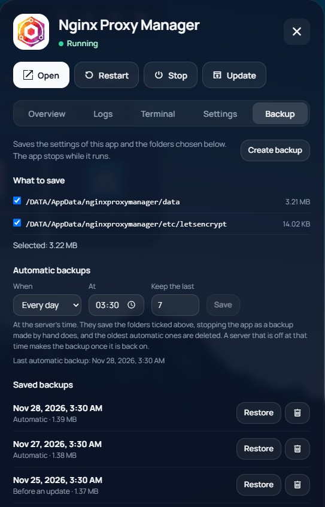</td>
    <td align="center">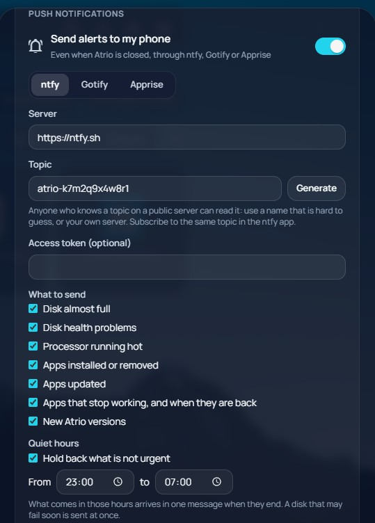</td>
  </tr>
  <tr>
    <td align="center">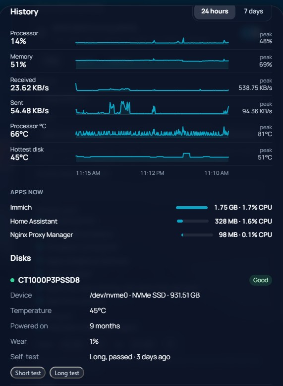</td>
    <td align="center">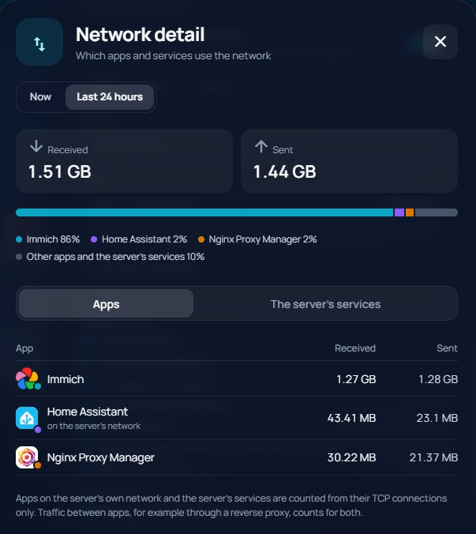</td>
  </tr>
  <tr>
    <td>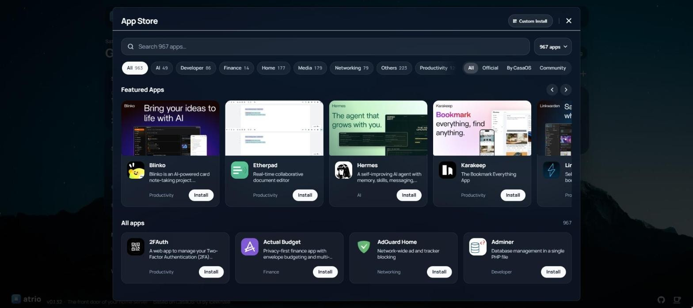</td>
    <td>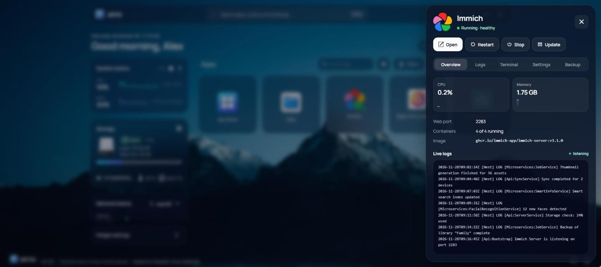</td>
  </tr>
  <tr>
    <td>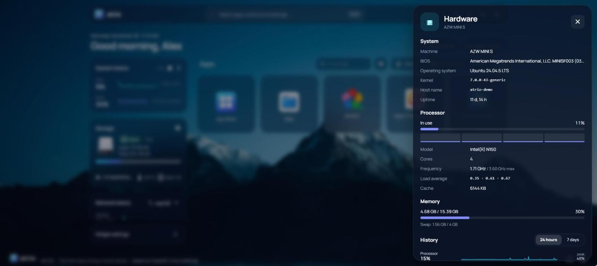</td>
    <td>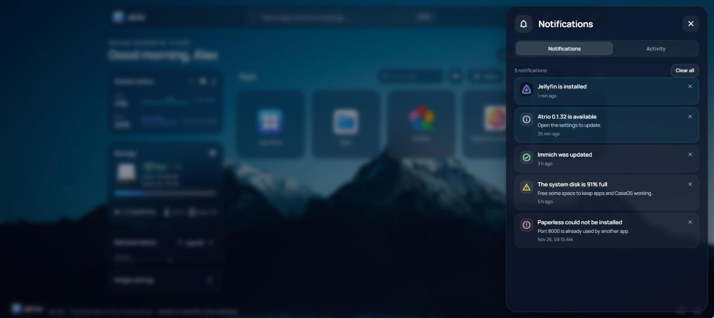</td>
  </tr>
  <tr>
    <td>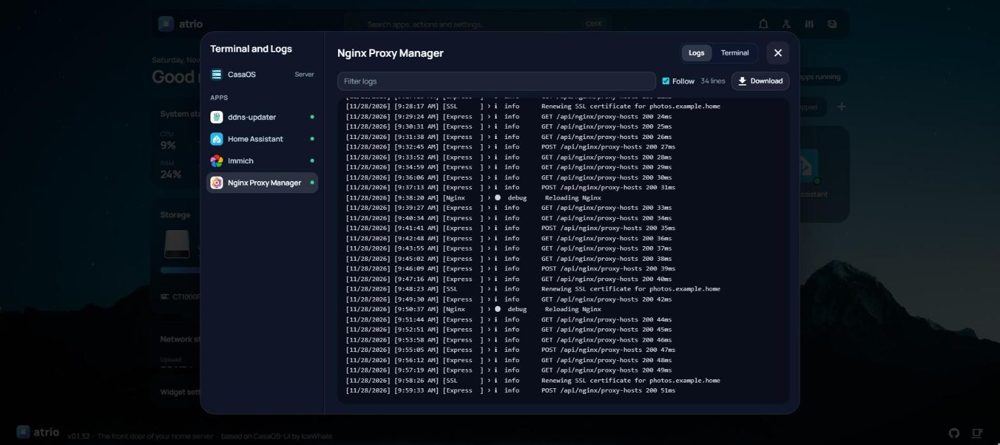</td>
    <td align="center">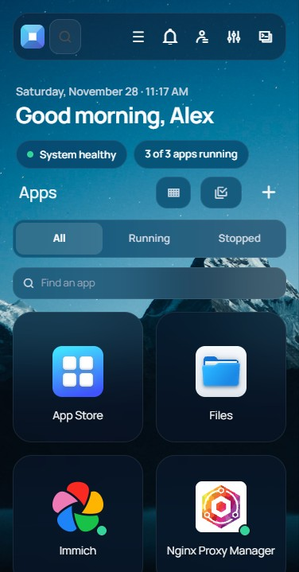</td>
  </tr>
</table>

Screenshots use demo data.

## Compatibility

Tested with CasaOS **v0.4.15**.

## Install

On the machine that runs CasaOS:

```shell
curl -fsSL https://raw.githubusercontent.com/peppeaiello/atrio/main/scripts/install.sh | sudo bash
```

Then reload CasaOS in your browser with `Ctrl+F5`. The script:

- saves a copy of the original CasaOS UI in `/var/lib/casaos/atrio/casaos-ui-original`;
- installs the latest [release](https://github.com/peppeaiello/atrio/releases) in `/var/lib/casaos/www`, the folder
  CasaOS serves its UI from;
- installs a small updater (`/usr/local/bin/atrio-update` and the `atrio-update.path` systemd unit);
- watches the UI folder (`atrio-restore.path`) so Atrio comes back on its own after a CasaOS update.
- installs the push alert service (`/usr/local/bin/atrio-alerts`, run every 5 minutes by `atrio-alerts.timer`),
  which stays off until you set it up in Settings → Push notifications;
- installs the backup service (`/usr/local/bin/atrio-backup`, with `atrio-backup.path`, `atrio-backup-schedule.timer`
  for automatic backups and app updates, and `atrio-check-updates.timer`, which looks for new versions of the apps every 6 hours).

Nothing else changes: CasaOS, your apps and their data are left as they are.

## Update

A red dot on the settings icon (the sliders at the top) tells you a new release is out. Open the settings: under
**Updates**, the **Atrio** row shows your version and an **Update** button. Atrio asks the updater on the server to
download the release from GitHub, checks its signature and installs it, showing each step, then reloads the page.
The services on the server (updater, push alerts, backups) are updated with it, from a bundle signed with the same
key.

Older installs need no command either. Their updater only installs the web UI, but each release carries its own
updater and public key, and the web UI, which those servers do receive, puts that updater in place of the old one
through CasaOS and asks for an update: the services are then brought up to date, and from then on every release
must be signed with the key. This stays on for good: whenever the services on the server are behind the web UI,
for whatever reason, Atrio puts them right by itself the next time it is opened. Only when that cannot work (for
example a CasaOS whose file manager is limited to some folders) does Atrio show the install command to run.

From a terminal you can do the same with `sudo atrio-update`.

Updating CasaOS puts its own UI back. About half a minute later the updater notices it, saves that newer CasaOS UI
as the copy used by the uninstaller, and installs Atrio again (from the last release it kept, if GitHub cannot be
reached), never a release older than one installed before. Installs made before Atrio 0.1.4 get this too, once
Atrio has brought their services up to date.

## Moving to a new machine

1. Before, on the old server: in Atrio's settings, **Settings file → Save** downloads one file with the dashboard,
   push alerts, backup folder and automatic backups, and the backup key, encrypted with a password you choose. Keep it
   off the server, with its password. Your app backups should be on another disk, a network folder or a cloud drive.
2. On the new machine, install CasaOS, then Atrio with the command above.
3. In Atrio's settings, **Settings file → Load** that file. Connect the disk, network folder or cloud drive with the
   backups in Files, and choose it again as the backup folder if its path changed.
4. Install each app again from the App Store, then in its **Backup** tab pick the backup to restore.

## Uninstall

```shell
curl -fsSL https://raw.githubusercontent.com/peppeaiello/atrio/main/scripts/uninstall.sh | sudo bash
```

It puts the original CasaOS UI back and removes the updater. Reload the page with `Ctrl+F5`.

## Support Atrio

Atrio is free, open source (Apache-2.0) and made by one person in their spare time. There are no paid features, no
ads and no telemetry, and that will not change.

If Atrio is useful to you and you would like to help, a small tip on Ko-fi goes towards the costs of the website and
the domain, and towards the time spent fixing bugs and adding features:

**[ko-fi.com/peppeaiello](https://ko-fi.com/peppeaiello)**

Other ways to help that cost nothing: star the repository, report bugs, translate a few strings, or tell one friend
who runs a home server. Thank you!

## Credits

Atrio builds on the work of the IceWhale team and the CasaOS community: thank you for making CasaOS and releasing
it as open source. The full commit history of CasaOS-UI is preserved in this repository.

## License

[Apache License 2.0](LICENSE), same as the original project. See [NOTICE](NOTICE) for attribution.
